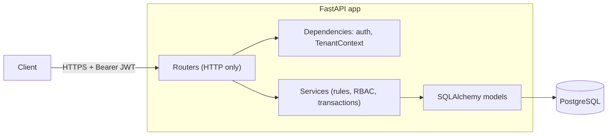

# TeamForge API

A multi-tenant project-management backend (think a small Jira/Linear core) built with
**FastAPI, PostgreSQL, SQLAlchemy 2 and Alembic**. Users register, create organizations, invite
teammates, and manage projects and tasks, with strict isolation between organizations.

> Portfolio project. It is tested and containerised, but it has **not been deployed or load-tested**.
> See [Known limitations](#known-limitations) for an honest list of what is and isn't covered.

## Features

- **Authentication**: registration, login, short-lived JWT access tokens, Argon2id password hashing
- **Multi-tenancy**: shared schema with an `organization_id` column; users may belong to many organizations
- **RBAC**: Owner / Admin / Member roles, checked at the service layer on every tenant-scoped write
- **Invitations**: random single-use tokens, stored only as SHA-256 hashes, expiring, email-bound
- **Safe ownership**: the "last owner" rule is enforced under a row lock, verified with concurrent-request tests
- **Projects**: create, list, update, archive/unarchive
- **Tasks**: statuses, priorities, due dates, assignees (validated against org membership)
- **Listing**: pagination (max 100), repeatable filters, allowlisted sorting, literal text search
- **Database-enforced tenant consistency**: composite foreign keys make cross-tenant references impossible
- **Operations**: JSON logs with secret redaction, request ids, health/readiness probes, Docker, CI

## Tech stack

Python 3.12 · FastAPI · PostgreSQL 17 · SQLAlchemy 2.x (synchronous) · Alembic · Pydantic v2 +
pydantic-settings · PyJWT · pwdlib (Argon2id) · pytest + httpx2 · uv · Ruff · Docker Compose · GitHub Actions

## Architecture at a glance



More detail: [docs/architecture.md](docs/architecture.md) · [docs/database.md](docs/database.md) ·
[docs/api.md](docs/api.md) · [docs/security.md](docs/security.md) ·
[docs/deployment.md](docs/deployment.md) · [docs/LEARNING_GUIDE.md](docs/LEARNING_GUIDE.md)

## Quick start (local development)

Prerequisites: Python 3.12+, [uv](https://docs.astral.sh/uv/), Docker.

```bash
git clone <your-repo-url> teamforge-api && cd teamforge-api
cp .env.example .env
```

Edit `.env`: set `POSTGRES_PASSWORD` and generate a JWT secret (at least 32 characters):

```bash
openssl rand -hex 32
```

Start PostgreSQL, migrate, and run the API with auto-reload:

```bash
docker compose up -d db
uv sync
uv run alembic upgrade head
uv run uvicorn app.main:app --reload
```

Open <http://127.0.0.1:8000/docs> for interactive Swagger UI.

### Run everything in Docker

```bash
docker compose up -d --build --wait   # db -> one-shot migrations -> api
curl http://127.0.0.1:8000/health/ready
```

## Example requests

```bash
API=http://127.0.0.1:8000/api/v1

# 1. Register and log in
curl -X POST $API/auth/register -H 'content-type: application/json' \
  -d '{"email":"ada@example.com","password":"Correct-Horse-9","full_name":"Ada"}'
TOKEN=$(curl -s -X POST $API/auth/login -H 'content-type: application/json' \
  -d '{"email":"ada@example.com","password":"Correct-Horse-9"}' | python3 -c 'import sys,json;print(json.load(sys.stdin)["access_token"])')

# 2. Create an organization (you become its OWNER), then a project and a task
ORG=$(curl -s -X POST $API/organizations -H "authorization: Bearer $TOKEN" \
  -H 'content-type: application/json' -d '{"name":"Acme"}' | python3 -c 'import sys,json;print(json.load(sys.stdin)["id"])')
PROJECT=$(curl -s -X POST $API/organizations/$ORG/projects -H "authorization: Bearer $TOKEN" \
  -H 'content-type: application/json' -d '{"name":"Website"}' | python3 -c 'import sys,json;print(json.load(sys.stdin)["id"])')
curl -X POST $API/organizations/$ORG/tasks -H "authorization: Bearer $TOKEN" \
  -H 'content-type: application/json' \
  -d "{\"project_id\":\"$PROJECT\",\"title\":\"Write docs\",\"priority\":\"HIGH\",\"due_date\":\"2030-01-31\"}"

# 3. Filter, sort, paginate
curl "$API/organizations/$ORG/tasks?status=TODO&priority=HIGH&sort_by=due_date&order=asc&limit=20" \
  -H "authorization: Bearer $TOKEN"
```

Inviting a teammate: `POST /organizations/{id}/invitations` creates the invitation. Email delivery is
**not implemented**; in development set `EXPOSE_INVITATION_TOKENS=true` and the raw token is returned
once in that response. The invitee then calls `POST /invitations/accept` with `{"token": "..."}`. This
flag is refused at startup when `APP_ENV=production`.

## Testing

Tests run against a real PostgreSQL (the Compose `db` service must be running). They create and drop a
separate `teamforge_test` database and build its schema with the real Alembic migrations, so your
development data is never touched.

```bash
docker compose up -d db
uv run pytest                       # full suite
uv run ruff check . && uv run ruff format --check .
```

| Area | Files |
|---|---|
| Foundation, logging, settings | `tests/test_foundation.py` |
| Database constraints and migrations | `tests/test_database.py` |
| Authentication and JWT edge cases | `tests/test_auth.py` |
| Organizations, invitations, members, RBAC | `tests/test_organizations.py`, `test_invitations.py`, `test_members_rbac.py` |
| Cross-tenant isolation | `tests/test_tenant_isolation.py` plus isolation sections in project/task tests |
| Role x endpoint matrix | `tests/test_authorization_matrix.py` |
| Projects, tasks, filtering | `tests/test_projects.py`, `test_tasks.py`, `test_task_filters.py` |
| Concurrency (real parallel requests) | `tests/test_concurrency.py` |
| Hostile input, hardening, indexes | `tests/test_security.py` |

## Security design (summary)

Full discussion in [docs/security.md](docs/security.md).

- Passwords: Argon2id; login does equal work for unknown users; errors never echo credentials
- JWT: fixed algorithm allowlist, required `exp`/`iat`/`sub`, roles are *not* in the token (read fresh per request)
- Tenant isolation: membership gate (404 for non-members), tenant-filtered queries, composite FKs
- Invitations: 256-bit random tokens, only the SHA-256 digest stored, never logged
- Input: Pydantic validation, length limits, NUL-byte rejection, sort-field allowlists, escaped `LIKE`

## Known limitations

Deliberately out of scope or not done; please do not read this project as production-ready:

- **No rate limiting or login throttling.** Put a reverse proxy/WAF in front, or add a limiter.
- **No refresh tokens or logout/revocation.** Access tokens live until they expire (default 30 min);
  removing a member or deactivating a user takes effect immediately because those are checked per request.
- **No email sending.** Invitation tokens must be delivered out of band.
- **No password reset, email verification or MFA.**
- **No audit-log table**; structured log lines record membership/ownership changes by id.
- **Registration reveals whether an email exists** (409). A common usability tradeoff; login does not.
- **Offset pagination** is simple but gets slower on very deep pages.
- **Single instance assumptions are fine, but untested at scale.** No load testing was done; there are no performance claims.
- **GitHub Actions workflow is written but has not been executed on GitHub yet.**
- **Not deployed anywhere.** [docs/deployment.md](docs/deployment.md) describes what a deployment needs.

## Future improvements

Refresh tokens and revocation, email delivery for invitations, password reset, rate limiting,
keyset pagination, audit log, Postgres row-level security as defense in depth, task comments and
activity history, OpenTelemetry tracing.

## Project layout

```
app/
  main.py            application factory, middleware, router registration
  core/              config, security (hashing/JWT), errors, logging, permissions (RBAC)
  db/                declarative base (naming convention), engine/session
  models/            SQLAlchemy models
  schemas/           Pydantic request/response models
  services/          business rules, authorization, transactions
  api/               dependencies (auth, tenant context, pagination) and routers
alembic/             migrations
tests/               pytest suite (real PostgreSQL)
docs/                architecture, schema, API, security, deployment, learning guide
```
