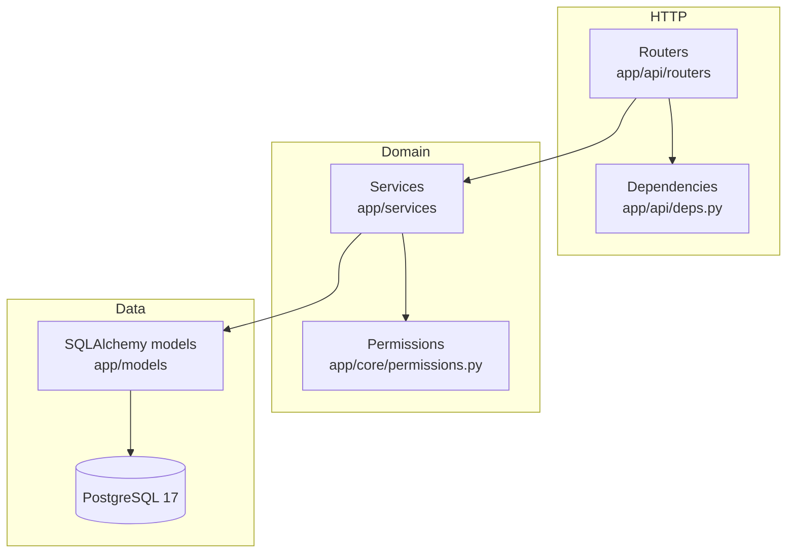

# Architecture

## Style: modular monolith, layered

One deployable FastAPI application. No microservices, queues or caches: nothing in the requirements
demonstrated a need for them.

| Layer | Responsibility | Must not |
|---|---|---|
| Router | Parse/validate HTTP, call one service function, shape the response | contain business rules |
| Dependencies | Authenticate (`get_current_user`), prove membership (`get_tenant_context`), pagination | write data |
| Service | Business rules, **authorization**, transactions (`commit`) | know about HTTP verbs/paths |
| Models | Table definitions, constraints, indexes | contain logic |

## Request lifecycle

1. Middleware assigns a server-generated request id and later logs method, route template, status, duration.
2. `get_current_user` validates the bearer JWT and loads the user (rejects deleted/inactive users).
3. For `/organizations/{org_id}/...`, `get_tenant_context` reads the caller's membership. No membership: **404**.
4. The router calls a service function with the `TenantContext` (user, organization id, role).
5. The service calls `authorize(ctx, Permission.X)`, runs tenant-filtered queries, and commits once.
6. Errors raise `AppError` subclasses; one handler renders `{"error": {"code", "message", "details?"}}`.

## Key decisions and tradeoffs

**Synchronous SQLAlchemy.** FastAPI runs plain `def` endpoints in a threadpool, so blocking DB calls do
not block the event loop. Async SQLAlchemy adds lazy-loading pitfalls and harder tests for little gain in a
CRUD workload. It can be revisited if profiling shows a need.

**Shared schema multi-tenancy** (`organization_id` on tenant-owned rows). Simplest to operate and migrate.
The weakness (one forgotten `WHERE` leaks data) is mitigated three ways: the tenant id comes from a
dependency that proves membership, every service query filters on it, and composite foreign keys make
cross-tenant references impossible in the database. Database-per-tenant or schema-per-tenant give stronger
isolation but multiply migration and operational cost. PostgreSQL row-level security was left out to keep
the model explainable; it is a sensible future defense in depth.

**Roles are not in the JWT.** The token only identifies the user. Roles are read from `memberships` on each
request, so demotions and removals apply immediately. Cost: one small indexed query per tenant request.

**404 for non-members, 403 for members lacking a permission.** A 403 would confirm that an organization
exists. A foreign organization and a nonexistent one produce byte-identical responses (tested).

**Services commit explicitly.** Each use case is one transaction; if anything raises before `commit`,
closing the session rolls everything back (tested for organization creation).

**No repository layer.** Services use the SQLAlchemy session directly. An extra layer would add files
without removing duplication at this size.

**Offset pagination** with a stable `id` tiebreaker. Simple and adequate here; keyset pagination is listed
as a future improvement for very deep pages.

## Concurrency

Ownership-affecting operations (change role, remove/leave) first run
`SELECT ... FROM organizations WHERE id = :org FOR UPDATE`. That serialises them per organization, then the
caller's role is **re-read** (the one loaded earlier could be stale), the owner count is checked, and the
change is written, all under the same lock. `tests/test_concurrency.py` fires truly parallel requests; with
the lock removed those tests fail (one run ended with an organization with zero owners), with it they pass.

Invitation acceptance locks the invitation row (`FOR UPDATE`) so a token can be redeemed once even if used
twice simultaneously. Duplicate registrations are decided by the unique index on `users.email`.
