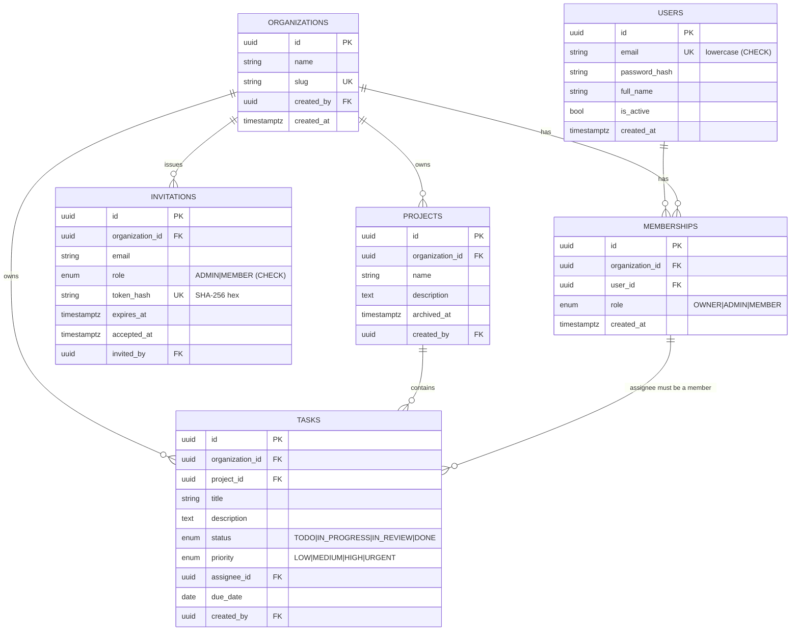

# Database schema

PostgreSQL 17, managed by Alembic (`alembic/versions`). All primary keys are UUIDs (not guessable or
enumerable). Constraint and index names follow a naming convention defined in `app/db/base.py`.



## Constraints that carry the security model

| Constraint | Table | Guarantees |
|---|---|---|
| `UNIQUE (organization_id, user_id)` | memberships | one membership per user per org; also the target of the assignee FK |
| `UNIQUE (id, organization_id)` | projects | lets tasks reference a project *together with* its organization |
| `FOREIGN KEY (project_id, organization_id) -> projects (id, organization_id)` | tasks | a task's project is always in the task's organization |
| `FOREIGN KEY (organization_id, assignee_id) -> memberships (organization_id, user_id)` | tasks | an assignee is always a member of the task's organization (skipped when `assignee_id` is NULL) |
| `CHECK (role <> 'OWNER')` | invitations | invitations can never grant ownership |
| partial `UNIQUE (organization_id, email) WHERE accepted_at IS NULL` | invitations | at most one pending invitation per email per org |
| `CHECK (email = lower(email))` | users | case-insensitive uniqueness without extensions |
| `CHECK (length(trim(name)) > 0)` | organizations, projects, tasks (title) | no blank names |
| `ON DELETE CASCADE` from organizations | memberships, invitations, projects, tasks | deleting an org removes its data |

Because the assignee foreign key has no cascade, removing a member whose tasks are still assigned is
refused by the database. `services/members.py` therefore unassigns those tasks in the same transaction.

## Indexes

| Index | Serves |
|---|---|
| `tasks (organization_id, created_at)` | default task list (newest first) |
| `tasks (organization_id, project_id, status)` | board view / status filters per project |
| `tasks (organization_id, assignee_id)` | "my tasks" |
| `tasks (organization_id, due_date)` | due-date range filters |
| `tasks (project_id)` | cascade deletes from projects |
| `projects (organization_id, created_at)` | project list |
| `memberships (user_id)` | "organizations I belong to" |

`tests/test_security.py` loads 40,000 tasks across 40 tenants, runs `ANALYZE`, and asserts that tenant-scoped
queries do not use sequential scans. This shows the indexes are *usable*; it is not a performance benchmark.

## Migrations

```bash
uv run alembic upgrade head                      # apply
uv run alembic revision --autogenerate -m "msg"  # create, then REVIEW the file by hand
uv run alembic check                             # fail if models and migrations diverge
```

The initial migration was edited by hand: the shared `role` enum is created once explicitly (autogenerate
would create it twice). `tests/test_database.py` runs `alembic check` and a downgrade/upgrade round trip.
